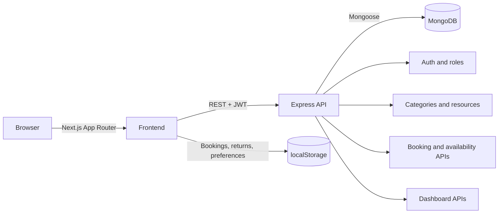

<div align="center">

# EquipBook

**A full-stack equipment and resource booking platform for university departments.**

[](https://nextjs.org/)
[](https://react.dev/)
[](https://www.typescriptlang.org/)
[](https://nodejs.org/)
[](https://expressjs.com/)
[](https://www.mongodb.com/)

Browse shared equipment, request bookings, and manage the complete issue-to-return lifecycle from a single workspace.

</div>

---

## Overview

EquipBook is a monorepo containing a **Next.js App Router frontend** and an **Express/MongoDB REST API**. It is designed around a university resource desk: students and faculty browse live equipment availability, while managers and administrators manage inventory, booking requests, returns, and operational dashboards.

The current implementation combines:

- Server-backed authentication, profiles, categories, resources, and catalogue administration.
- A complete browser-local demo workflow for bookings, returns, and preferences.
- Seed data for 8 demo users, 5 categories, and 17 resources.

> **Scope note:** The backend exposes booking and availability endpoints, but the current frontend intentionally keeps booking, return, and preference data in `localStorage` for the demo. See [Data Ownership](#data-ownership) before treating this as a production booking system.

---

## Table of Contents

- [Features](#features)
- [Architecture](#architecture)
- [Tech Stack](#tech-stack)
- [Project Structure](#project-structure)
- [Getting Started](#getting-started)
  - [Prerequisites](#prerequisites)
  - [1. Clone the repository](#1-clone-the-repository)
  - [2. Set up the backend](#2-set-up-the-backend)
  - [3. Set up the frontend](#3-set-up-the-frontend)
- [Environment Variables](#environment-variables)
- [Demo Accounts](#demo-accounts)
- [Roles and Permissions](#roles-and-permissions)
- [Available Scripts](#available-scripts)
- [API Overview](#api-overview)
- [Data Ownership](#data-ownership)
- [Testing](#testing)
- [Production Notes](#production-notes)
- [Security](#security)
- [Roadmap](#roadmap)
- [License](#license)

---

## Features

### Authentication and accounts

- Registration for `student`, `employee`, and `faculty` accounts.
- JWT login with seven-day token expiry.
- Session restoration through `GET /api/auth/me`.
- Profile updates for name, department, and phone.
- Password changes with current-password verification.
- Route guards and role-aware portal access.
- Automatic token clearing on `401`/`403` responses.

### Equipment catalogue

- Server-backed categories and resources from MongoDB.
- Search, category, location, availability, and status filters.
- Resource details including asset tag, stock, collection location, instructions, and booking requirements.
- Automatic asset-tag generation for new resources.
- Category and resource CRUD for managers and administrators.
- Guard against deleting categories that still contain resources.
- Responsive catalogue cards and image handling.

### Booking and return workflow

- Availability-aware booking form with date and quantity validation.
- Pending, approved, rejected, cancelled, completed, and issued states.
- User booking list, detail view, history, and cancellation flow.
- Manager review queue with approval/rejection decisions.
- Daily booking calendar and usage analytics.
- Issue and return dialogs with condition and quantity tracking.
- Local guard against deleting a resource with active bookings.

### Dashboards and administration

- Personal dashboard with welcome, upcoming bookings, and recent activity.
- Admin operations dashboard with inventory and request metrics.
- All-bookings view with search, filters, status badges, and CSV export.
- Resource inventory management with stock and maintenance controls.
- Category management and workspace settings.
- Local demo reset that preserves the server catalogue and active session.

### User experience

- Responsive App Router layouts for desktop and mobile.
- Accessible Radix-based dialogs, menus, tabs, selects, and calendars.
- Form validation with React Hook Form and Zod.
- Toast feedback for mutations and recoverable errors.
- Offline/session-error states with retry actions.
- Consistent loading skeletons and empty states.

---

## Architecture



### Application layers

| Layer | Responsibility |
| --- | --- |
| `frontend/src/app` | App Router pages, route groups, layouts, and metadata |
| `frontend/src/features` | Feature-specific UI, forms, schemas, and utilities |
| `frontend/src/components` | Shared layout, display, and primitive UI components |
| `frontend/src/context` | Authentication and application state providers |
| `frontend/src/services` | Typed API clients for backend resources |
| `frontend/src/lib` | API transport, token storage, constants, storage, and helpers |
| `backend/controllers` | Request validation and domain operations |
| `backend/models` | Mongoose schemas and indexes |
| `backend/routes` | HTTP route definitions and middleware composition |
| `backend/middleware` | JWT protection, role authorization, and error handling |

### Authentication flow

1. The user signs in or registers through the frontend.
2. The API returns a JWT and user profile.
3. The frontend stores the token under `equipbook.auth` in `localStorage`.
4. `AuthProvider` restores the session with `GET /api/auth/me`.
5. `api-client` attaches the bearer token to protected requests.
6. A `401`/`403` response clears the token and returns the user to `/login`.

---

## Tech Stack

| Area | Technology |
| --- | --- |
| Frontend framework | Next.js 16.4.6 (App Router) |
| UI runtime | React 19.3 |
| Language | TypeScript 5 |
| Styling | Tailwind CSS 4 |
| Components | Radix UI, custom shadcn-style primitives, Lucide icons |
| Forms | React Hook Form 7, Zod 4 |
| Charts | Recharts 3 |
| Notifications | Sonner |
| Backend runtime | Node.js 20.19+ |
| API framework | Express 5 |
| Database | MongoDB with Mongoose 9 |
| Authentication | JSON Web Tokens, bcryptjs |
| Security | Helmet, CORS, express-rate-limit |
| Tooling | ESLint 9, npm |

---

## Project Structure

```text
EquipBook/
├── backend/
│   ├── config/              # MongoDB connection
│   ├── controllers/         # Auth, users, categories, resources, bookings, dashboards
│   ├── middleware/          # JWT protection, role checks, error handling
│   ├── models/              # Mongoose schemas
│   ├── routes/              # Express route definitions
│   ├── scripts/             # API and profile regression scripts
│   ├── utils/               # HTTP error helper
│   ├── seed-data.js         # Demo users, categories, and resources
│   ├── seed.js              # Idempotent seed runner
│   ├── server.js            # API entry point
│   ├── .env.example
│   ├── package.json
│   └── README.md            # Full API reference
│
├── frontend/
│   ├── public/              # Static artwork
│   ├── src/
│   │   ├── app/
│   │   │   ├── (auth)/      # Login and registration
│   │   │   ├── (user)/      # User workspace routes
│   │   │   └── admin/       # Staff operations routes
│   │   ├── components/      # UI primitives, shared components, layout
│   │   ├── config/          # Navigation configuration
│   │   ├── context/         # Auth and application providers
│   │   ├── features/        # Auth, bookings, resources, profile, admin, settings
│   │   ├── hooks/           # Shared hooks
│   │   ├── lib/             # API client, storage, constants, utilities
│   │   ├── services/        # Typed backend service clients
│   │   └── types/           # Shared domain types
│   ├── .env.example
│   ├── next.config.ts
│   └── package.json
│
├── README.md
```

---

## Getting Started

### Prerequisites

- **Node.js 20.19 or newer**
- **npm 10 or newer**
- **MongoDB Atlas** or a local MongoDB instance
- A modern browser

### 1. Clone the repository

```bash
git clone https://github.com/BachhavPritesh/EquipBook.git
cd EquipBook
```

### 2. Set up the backend

```bash
cd backend
npm install
cp .env.example .env
```

Edit `backend/.env` and set at minimum:

```dotenv
MONGO_URI=mongodb+srv://<username>:<password>@<cluster>/equipbook?retryWrites=true&w=majority
JWT_SECRET=replace-with-a-long-random-secret
```

Seed the demo catalogue and accounts, then start the API:

```bash
npm run seed
npm run dev
```

The API runs at `http://localhost:5000`. Confirm it is healthy:

```bash
curl http://localhost:5000/api/health
```

Expected response:

```json
{
  "success": true,
  "message": "EquipBook API is running",
  "data": {
    "database": "connected",
    "timestamp": "2026-11-17T15:00:00.000Z"
  }
}
```

If you use MongoDB Atlas, allow your current IP under **Atlas → Network Access**.

### 3. Set up the frontend

In a second terminal:

```bash
cd frontend
npm install
cp .env.example .env.local
npm run dev
```

Open [http://localhost:3000](http://localhost:3000).

Default frontend configuration:

```dotenv
NEXT_PUBLIC_API_URL=http://localhost:5000/api
```

The backend must allow the frontend origin through `CLIENT_URL` (defaults to `http://localhost:3000`).

---

## Environment Variables

### Backend (`backend/.env`)

| Variable | Required | Default | Description |
| --- | --- | --- | --- |
| `PORT` | No | `5000` | API server port |
| `NODE_ENV` | No | `development` | Runtime environment |
| `CLIENT_URL` | No | `http://localhost:3000` | Allowed CORS origin |
| `MONGO_URI` | **Yes** | — | MongoDB connection string |
| `JWT_SECRET` | **Yes** | — | Secret used to sign JWTs; the server exits if missing |

### Frontend (`frontend/.env.local`)

| Variable | Required | Default | Description |
| --- | --- | --- | --- |
| `NEXT_PUBLIC_API_URL` | No | `http://localhost:5000/api` | Public base URL for the backend API; set this for deployed environments |

Never commit `.env` or `.env.local`. Only the example files belong in version control.

---

## Demo Accounts

Run `npm run seed` in `backend/` to create these accounts. The password for every demo account is `demo1234`.

| Name | Email | Role |
| --- | --- | --- |
| Aarav Mehta | `aarav.mehta@northbridge.edu` | student |
| Priya Nair | `priya.nair@northbridge.edu` | manager |
| Maya Chen | `maya.chen@northbridge.edu` | faculty |
| Daniel Okafor | `daniel.okafor@northbridge.edu` | employee |
| Sofia Ramirez | `sofia.ramirez@northbridge.edu` | student |
| Liam Patel | `liam.patel@northbridge.edu` | student |
| Emma Johansson | `emma.johansson@northbridge.edu` | faculty |
| Noah Williams | `noah.williams@northbridge.edu` | employee |

`manager` and `admin` are staff roles. There is no seeded administrator; promote a user in MongoDB if you need to test admin-only role management:

```js
db.users.updateOne(
  { email: "priya.nair@northbridge.edu" },
  { $set: { role: "admin" } }
)
```

The seed script is idempotent: a second run updates existing records instead of duplicating them.

---

## Roles and Permissions

| Action | student / employee / faculty | manager | admin |
| --- | :---: | :---: | :---: |
| Register, log in, view own profile | Yes | Yes | Yes |
| Browse categories and resources | Yes | Yes | Yes |
| Create and view own bookings | Yes | Yes | Yes |
| View own dashboard | Yes | Yes | Yes |
| View all bookings | No | Yes | Yes |
| Approve or reject bookings | No | Yes | Yes |
| Manage categories and resources | No | Yes | Yes |
| View all users | No | Yes | Yes |
| Change user roles | No | No | Yes |

Additional safety rules:

- Public registration cannot create `manager` or `admin` accounts.
- Staff cannot approve or reject their own booking.
- Only pending bookings can be cancelled or decided.
- The last remaining administrator cannot be demoted.
- Resources with active local bookings cannot be deleted from the admin UI.

---

## Available Scripts

### Backend

| Command | Description |
| --- | --- |
| `npm run dev` | Start the API with Node watch mode |
| `npm start` | Start the API without file watching |
| `npm run seed` | Create or update demo users, categories, and resources |
| `npm run test:api` | Run the end-to-end API regression script |
| `npm run test:profile` | Run the profile update regression script |

`test:api` and `test:profile` require a configured `.env`, a running API, and database access.

### Frontend

| Command | Description |
| --- | --- |
| `npm run dev` | Start the Next.js development server |
| `npm run build` | Create a production build |
| `npm start` | Serve the production build |
| `npm run lint` | Run ESLint |

---

## API Overview

Base URL: `http://localhost:5000/api`

| Area | Endpoints | Access |
| --- | --- | --- |
| Health | `GET /health` | Public |
| Authentication | `POST /auth/register`, `POST /auth/login`, `GET /auth/me`, `PUT /auth/me`, `PUT /auth/password` | Public / authenticated |
| Users | `GET /users`, `GET /users/:id`, `PUT /users/:id/role` | Manager/admin; role changes admin-only |
| Categories | `GET /categories`, `GET /categories/:id`, `POST /categories`, `PUT /categories/:id`, `DELETE /categories/:id` | Public reads; staff writes |
| Resources | `GET /resources`, `GET /resources/:id`, `POST /resources`, `PUT /resources/:id`, `DELETE /resources/:id` | Public reads; staff writes |
| Availability | `GET /availability` | Authenticated |
| Bookings | `POST /bookings`, `GET /bookings`, `GET /bookings/:id`, `PUT /bookings/:id/cancel`, `PUT /bookings/:id/approve`, `PUT /bookings/:id/reject`, `PUT /bookings/:id/notes` | Authenticated; decisions staff-only |
| Dashboards | `GET /dashboard/user`, `GET /dashboard/admin` | Authenticated; admin dashboard staff-only |

Responses use a consistent envelope:

```json
{
  "success": true,
  "message": "Resources loaded successfully",
  "data": {}
}
```

Errors follow the same shape with `success: false` and an appropriate HTTP status code. See [`backend/README.md`](backend/README.md) for request bodies, validation rules, status codes, and availability calculations.

---

## Data Ownership

Understanding what is server-backed versus browser-local is important when extending the project.

| Domain | Storage | Notes |
| --- | --- | --- |
| Authentication and sessions | MongoDB + JWT | Token stored in browser `localStorage` |
| User profiles | MongoDB | Name, department, phone, role |
| Categories | MongoDB | Public reads, staff mutations |
| Resources | MongoDB | Public reads, staff mutations |
| Bookings | Browser `localStorage` | Current frontend demo workflow |
| Returns | Browser `localStorage` | Current frontend demo workflow |
| Preferences | Browser `localStorage` | Per-browser notification/display settings |

The backend booking API is available for a future integration, but the current frontend does not persist bookings or returns to MongoDB. Clearing browser storage resets that demo data. **Reset local demo data** restores sample bookings and preferences while preserving the server catalogue and signed-in account.

---

## Testing

### Backend regression scripts

With the API running and `backend/.env` configured:

```bash
cd backend
npm run test:api
npm run test:profile
```

The API script exercises authentication, role restrictions, category/resource CRUD, validation, filtering, sorting, and deletion rules. The profile script verifies persisted profile updates.

### Frontend checks

```bash
cd frontend
npm run lint
npm run build
```

For a clean verification, seed twice and confirm the second run reports `0 created, 30 updated`, then confirm the catalogue totals are **8 users, 5 categories, and 17 resources**.

---

## Production Notes

Before deploying:

1. Set `NODE_ENV=production` and use a strong, unique `JWT_SECRET`.
2. Restrict `CLIENT_URL` and MongoDB Atlas network access.
3. Point `NEXT_PUBLIC_API_URL` at the deployed API over HTTPS.
4. Run `npm run build` for the frontend and serve it with `npm start`.
5. Run the backend with a process manager and a production MongoDB instance.
6. Add production monitoring, backups, and request logging.
7. Replace the browser-local booking/return flow with the backend booking API before using this for real reservations.
8. Allowlist any additional image hosts in `frontend/next.config.ts`; arbitrary remote hosts are intentionally rejected by `next/image`.

### Deployment topology

```text
Web browser
    |
    v
Next.js frontend  ──────>  Express API  ──────>  MongoDB
    (HTTPS)                     (HTTPS)               (managed)
```

---

## Security

- Passwords are hashed with bcryptjs at 10 salt rounds.
- JWTs expire after seven days.
- Helmet adds security headers; CORS is restricted by `CLIENT_URL`.
- API traffic is rate-limited to 300 requests per IP per 15 minutes.
- Role authorization is enforced on protected routes.
- Public registration cannot create staff accounts.
- Environment files are excluded from version control.
- Remote image hosts are explicitly allowlisted in the frontend configuration.

Report security issues privately to the repository owner rather than opening a public issue with exploit details.

---

## Roadmap

- Persist bookings, returns, and issue records through the backend API.
- Add notification delivery for approval, rejection, and return reminders.
- Add an admin user-management screen and role-change audit trail.
- Add password reset and email verification flows.
- Add automated frontend component and end-to-end tests.
- Add CI checks for linting, builds, and regression scripts.
- Add deployment configuration for the frontend and API.

---

## License

No license file is currently included in this repository. Add a license before redistributing or reusing the project outside its intended coursework/demo context.

---

<div align="center">

Built with Next.js, React, TypeScript, Express, and MongoDB.

</div>
